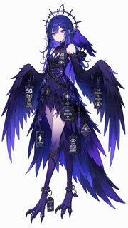
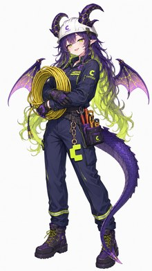

# Model Muses

> 32 AI models & platforms · 32 standing portraits + 51 more in the gallery · technical profiles · per-image provenance

本仓库收录 32 个主流大模型、AI 工具、算力与边缘基础设施的拟人形象立绘原画。全部图片出自**同一位画师、同一画风**的白底全身立绘，规格统一，可横向对比。其中 22 个对象取自蓝色大肥鱼站的立绘作品页并逐张完成溯源匹配；**文心一言娘**为轮椅坐姿设定、取自 [ai-chan-sheets](https://github.com/lmy414/ai-chan-sheets) 的参考原图目录（同一画师笔下的原始作品），不在原站作品库中，出处与差异见 [docs/来源与版权.md](docs/来源与版权.md)。

**这个 README 只有一张表，收图标准也就一条：白底、竖版、单人、全身。** 因为它的用途是横向对照——32 行并排看下来，谁的配色更冷、谁的识别符号更清楚，一眼就能比出来。混进横版、带场景、带字的图，这个比较就失效了。

但同一个角色被画过的样子远不止这一张。所以另开了两个地方：

| 去处 | 收什么 | 现在有多少 |
| --- | --- | --- |
| [**画廊**](docs/画廊.md) | **任何类型**：立绘、带场景的插画、梗图、三视图、漫画 | 63 张，每张都能点开看原图 |
| [**画廊索引**](docs/画廊索引.md) | 站内全部作品的缩略图墙，含 1040 件原站未署名的 | 1075 件，点图进原作品页 |
| [**跨平台来源**](docs/跨平台来源.md) | 站外还有哪些地方有技术拟人图、拿到了什么、为什么大部分没收 | 9 个平台 |

画廊里每一张图都带预览和跳转：**点图看原图，点标题看作品页与授权出处。** 逛起来跟看画册差不多。

每张图配一段**对象本体的技术说明**——它属于哪一类技术、采用什么架构机制、在什么方向上有独特性。**只写稳定事实，不写版本号、跑分、价格与市场份额**；下表为压缩版，更完整的对照见 [docs/角色设定与设计规律.md](docs/角色设定与设计规律.md)。

> **怎么看这张表**：点左侧缩略图可以打开原图，点左侧的对象名可以进官网。想按类型随便翻翻，直接去 [画廊](docs/画廊.md)。

<table>
<tr>
<td width="170"><b>DeepSeek</b><br><a href="https://www.deepseek.com/">官网</a> · <a href="https://api-docs.deepseek.com/">API 文档</a> · <a href="https://github.com/deepseek-ai">GitHub</a></td>
<td width="130" align="center"><a href="原画/deepseek-ref.jpg" title="点开看原图"></a></td>
<td>DeepSeek（深度求索）背后是量化投资公司幻方量化，模型走稀疏 MoE 路线。注意力侧从早期的 <b>MLA</b> 换到<b>混合注意力</b>——压缩稀疏注意力沿序列维度压 KV cache，叠一层深度压缩注意力兼顾密集读；结构上用<b>流形约束超连接</b>把残差映射约束到双随机矩阵流形，配 <b>Muon</b> 优化器稳收敛。训练保留<b>多 token 预测</b>，强化学习后训练走自研 <b>GRPO</b>；推理分非思考 / 高思考 / 极限三档，视觉侧以「<b>视觉原语</b>」把点与框坐标当推理单元。MIT 开放。</td>
</tr>
<tr>
<td width="170"><b>GPT（OpenAI）</b><br><a href="https://openai.com/">官网</a> · <a href="https://platform.openai.com/docs">开发者文档</a> · <a href="https://github.com/openai">GitHub</a></td>
<td width="130" align="center"><a href="原画/gpt-ref.jpg" title="点开看原图"></a></td>
<td>GPT 来自 OpenAI，是闭源前沿通用模型的代表。真正的护城河在<b>工具调用协议与生态集成</b>——结构化接口稳定驱动外部工具，长流程不易崩格式，第三方 Agent 框架的适配面最大；近年重心进一步转向<b>可执行的编程代理</b>形态，把推理直接落成对仓库与环境的操作。闭源，不可自部署。</td>
</tr>
<tr>
<td width="170"><b>Claude（Anthropic）</b><br><a href="https://www.anthropic.com/">官网</a> · <a href="https://docs.claude.com/">文档</a> · <a href="https://github.com/anthropics">GitHub</a></td>
<td width="130" align="center"><a href="原画/claude-ref.jpg" title="点开看原图"></a></td>
<td>Claude 出自 Anthropic，主打<b>长程智能体可靠性与代码能力</b>。四个关键机制：<b>可调推理强度</b>（effort 从低到最高多档，另设供长程任务用的扩展档，同一模型即可切换快慢与花费）、<b>自适应思考</b>（由模型自行判断哪一步值得深想）、<b>上下文压缩</b>（接近阈值时服务端自动摘要旧上下文，可配阈值）、以及<b>提示缓存</b>（复用历史前缀，Agent 循环不重复付费）。Agent 侧已从单代理走向<b>多代理协作</b>。</td>
</tr>
<tr>
<td width="170"><b>Gemini（Google）</b><br><a href="https://deepmind.google/models/gemini/">模型页</a> · <a href="https://ai.google.dev/gemini-api/docs">API 文档</a> · <a href="https://github.com/google-deepmind">GitHub</a></td>
<td width="130" align="center"><a href="原画/gemini-ref.jpg" title="点开看原图"></a></td>
<td>Gemini 出自 Google DeepMind，是唯一以<b>原生多模态</b>为核心的全栈模型：单模型同时处理文本、图像、音频、视频、PDF 与代码，无需外挂专用模型拼接。推理深度可按档位调节；与 Google 搜索、地图等第一方服务<b>原生打通</b>，可直接注入已验证的检索结果。</td>
</tr>
<tr>
<td width="170"><b>Grok（xAI）</b><br><a href="https://x.ai/">官网</a> · <a href="https://docs.x.ai/">API 文档</a> · <a href="https://github.com/xai-org">GitHub</a></td>
<td width="130" align="center"><a href="原画/grok-ref.jpg" title="点开看原图"></a></td>
<td>Grok 来自马斯克的 xAI，是通用对话与推理模型。差异点是<b>实时性</b>——检索层直接接 X 平台的数据流，DeepSearch 一类能力会读取当下社交帖子与突发新闻，而非依赖训练截止的静态知识。输出侧由 <b>Skills</b> 机制承接：把一次教会的工作流存成账号级技能，跨会话复用，并直接产出可下载的 Office 文档与 PDF；单次请求支持上百个并行工具调用。代价是来源缺少权威性筛选。</td>
</tr>
<tr>
<td width="170"><b>Kimi（月之暗面）</b><br><a href="https://www.moonshot.cn/">官网</a> · <a href="https://platform.moonshot.cn/">开放平台</a> · <a href="https://github.com/MoonshotAI">GitHub</a></td>
<td width="130" align="center"><a href="原画/kimi-ref.jpg" title="点开看原图"></a></td>
<td>Kimi 来自月之暗面（Moonshot AI），走 MoE 路线，自研 <b>Kimi Delta Attention</b> 混合线性注意力与<b>注意力残差</b>，配合量化感知训练直接产出低比特权重，支撑起百万级上下文。模型系列本身即 <b>agentic</b>，接上工具能自主完成多步任务。推理侧为<b>混合思考模式</b>。开放权重，采用带附加条件的开放许可。</td>
</tr>
<tr>
<td width="170"><b>Qwen（通义千问）</b><br><a href="https://qwenlm.github.io/">官网</a> · <a href="https://github.com/QwenLM">GitHub</a></td>
<td width="130" align="center"><a href="原画/qwen-ref.jpg" title="点开看原图"></a></td>
<td>Qwen（通义千问）是阿里云通义团队的开源模型系列，<b>覆盖最全的一条产品线</b>：轻量稠密到大规模 MoE，端侧到企业级。技术亮点是<b>混合思考模式</b>（开关切换分步推理与快速响应，配思考预算控成本）、多语言支持、统一多模态编码与<b>原生 MCP</b>。全系 Apache 2.0，商用无限制。</td>
</tr>
<tr>
<td width="170"><b>GLM（智谱）</b><br><a href="https://docs.bigmodel.cn/">开放文档</a> · <a href="https://github.com/THUDM">GitHub</a></td>
<td width="130" align="center"><a href="原画/glm-ref.jpg" title="点开看原图"></a></td>
<td>GLM 出自智谱（Zhipu AI，源自清华知识工程实验室），采用 MoE 架构。<b>参数效率</b>是核心卖点——轻量版本可比肩更大的闭源模型。<b>混合推理模式</b>可切，针对工具调用、网页浏览与软件工程做了专门优化；另有<b>原生多模态分支</b>，与 OCR、语音、图像生成等细分模型构成全模态矩阵。权重以 MIT 协议开放。</td>
</tr>
<tr>
<td width="170"><b>混元（腾讯）</b><br><a href="https://github.com/Tencent-Hunyuan">GitHub</a> · <a href="https://hunyuan.tencent.com/">混元官网</a></td>
<td width="130" align="center"><a href="原画/hunyuan-ref.jpg" title="点开看原图"></a></td>
<td>混元是腾讯自研的大模型系列，走<b>中文语料加全模态</b>路线，文本、图像、语音、视频与 3D 生成并行推进。深度依托腾讯云与微信生态，针对中文语境与本土知识优化。开源版本覆盖语言、<b>视频世界模型</b>与 <b>3D 重建</b>方向：前者按片段生成、过程中可用文字介入改写场景，后者能在单张消费级显卡上秒级重建 3D 世界。多个项目以 Apache 2.0 协议发布。</td>
</tr>
<tr>
<td width="170"><b>豆包 Seed（字节跳动）</b><br><a href="https://seed.bytedance.com/">Seed 官网</a> · <a href="https://www.volcengine.com/docs/ark">火山方舟文档</a> · <a href="https://github.com/volcengine">GitHub</a></td>
<td width="130" align="center"><a href="原画/seed-ref.jpg" title="点开看原图"></a></td>
<td>豆包 Seed 是字节跳动 Seed 团队的模型系列，经火山引擎对外提供服务，主线是<b>统一多模态架构</b>——单主干同时接收文本、图像、视频、音频并做跨模态联合推理，而非拼接多个专用模型。工程重点在视觉编码器瘦身与长上下文访存成本。产品侧另有一条<b>按周迭代的动态模型</b>，以统一模型 ID 持续推送最新版本；生成侧另有图像、视频、语音与 3D 资产的独立模型线。</td>
</tr>
<tr>
<td width="170"><b>文心一言（百度）</b><br><a href="https://yiyan.baidu.com/">产品页</a> · <a href="https://ernie.baidu.com/">文心官方博客</a> · <a href="https://github.com/PaddlePaddle/ERNIE">开源仓库</a></td>
<td width="130" align="center"><a href="原画/wenxin-ref.jpg" title="点开看原图"></a></td>
<td>文心一言（百度，2025 年 11 月起品牌统一为「文心」）的本体是文心大模型 ERNIE 系列。技术基因是<b>知识增强</b>——预训练阶段融入大规模知识图谱。旗舰走<b>原生全模态</b>：文本、图像、音频、视频映射进同一符号空间，用统一的「<b>下一组 token 预测</b>」端到端优化，分模态再各设专门目标（视觉走下一帧与尺度预测、音频走下一编解码预测），而非在后挂专用解码器；MoE 用<b>模态无关路由</b>，专家按 token 特征而非模态分配。开源侧另有 Apache 2.0 的多模态异构 MoE 系列。</td>
</tr>
<tr>
<td width="170"><b>阶跃星辰（StepFun）</b><br><a href="https://www.stepfun.com/">官网</a> · <a href="https://platform.stepfun.com/">开放平台</a> · <a href="https://github.com/stepfun-ai">GitHub</a></td>
<td width="130" align="center"><a href="原画/stepfun-ref.jpg" title="点开看原图"></a></td>
<td>阶跃星辰（StepFun）是 2023 年 4 月成立于上海的基础模型公司，创始人姜大昕此前任微软全球副总裁。路线是<b>原生多模态</b>——模型从训练之初就统一处理文本、图像与视频，而不是在语言主干上外挂视觉编码器。产品结构为一个 Step 基座向上生长，多模态与<b>端云结合</b>两条线并行：轻量模型下沉到手机、汽车与 IoT，另配 <b>Step-GUI</b> 一类图形界面智能体做跨应用操作，复杂任务再上云。开源与闭源 API 双轨。</td>
</tr>
<tr>
<td width="170"><b>MiMo（小米）</b><br><a href="https://mimo.xiaomi.com/zh/">官网</a> · <a href="https://www.xiaomi-mimo-ai.com/">模型站</a> · <a href="https://github.com/XiaomiMiMo">GitHub</a></td>
<td width="130" align="center"><a href="原画/mimo-ref.jpg" title="点开看原图"></a></td>
<td>MiMo 是小米自研的大模型系列，走<b>推理优先</b>路线。架构上是 MoE 加<b>动态激活</b>——按 token 选专家，把激活参数压到远小于总量，配<b>混合注意力</b>与<b>多层多 token 预测</b>，解码速度明显快于同档稠密模型。<b>端侧优先</b>是它最鲜明的取向：INT4 量化、结构化剪枝与硬件感知 kernel 让它能跑在手机、车机与音箱上，而不只是云端。产品线从端侧小模型一路铺到万亿级 MoE 旗舰，另有全模态、语音、视觉与终端编码 agent 等分支。权重以 MIT 协议开放，可商用与微调。</td>
</tr>
<tr>
<td width="170"><b>Llama（Meta）</b><br><a href="https://llama.meta.com/">官网</a> · <a href="https://huggingface.co/meta-llama">模型页</a></td>
<td width="130" align="center"><a href="原画/llama-ref.jpg" title="点开看原图"></a></td>
<td>Llama 来自 Meta，是<b>开放权重路线</b>的代表：权重公开，衍生出大量微调版与量化版，主导私有化部署与学术复现生态，最新一代采用<b>早期融合的原生多模态 MoE</b> 设计。它同时是别人的底座——多个主流产品以其为基座后训练。授权为社区许可：可商用，但须标注「Built with Llama」、衍生模型名以 Llama 开头，且超出月活阈值的大平台需单独取得授权。</td>
</tr>
<tr>
<td width="170"><b>Mistral AI</b><br><a href="https://mistral.ai/">官网</a> · <a href="https://docs.mistral.ai/">文档</a> · <a href="https://github.com/mistralai">GitHub</a></td>
<td width="130" align="center"><a href="原画/mistral-ref.jpg" title="点开看原图"></a></td>
<td>Mistral AI 是一家总部位于巴黎的欧洲厂商，以<b>高效小模型与开放权重</b>著称：参数压得比同档更狠而质量不降，小尺寸系列广泛用于端侧与边缘部署，另有稀疏 MoE 版与长文档结构化输出模型。授权分层明确——多数开源模型用 Apache 2.0，部分走改版 MIT（月营收超阈值需转商业授权），旗舰模型则提供非商用免费与商业授权两条路。另有 OCR、语音等周边模型。</td>
</tr>
<tr>
<td width="170"><b>MiniMax</b><br><a href="https://www.minimax.io/">官网</a> · <a href="https://platform.minimax.io/docs">平台文档</a> · <a href="https://github.com/MiniMax-AI">GitHub</a></td>
<td width="130" align="center"><a href="原画/minimax-ref.jpg" title="点开看原图"></a></td>
<td>MiniMax（稀宇科技）是上海的基础模型公司，本体是<b>全模态自研底座</b>：文本、语音、视频、音乐全部自研而非集成他人。工程路线上以自研<b>线性注意力</b>打破注意力复杂度带来的上下文长度限制，后续转向稀疏注意力架构。生成侧已做到单模型同时输出带原生立体声的高分辨率视频——对白、音效与环境声在同一次生成中完成，靠自研的高压缩 tokenizer 降低生成开销，并开放了权重供本地部署。</td>
</tr>
<tr>
<td width="170"><b>Perplexity</b><br><a href="https://www.perplexity.ai/">官网</a> · <a href="https://docs.perplexity.ai/">API 文档</a> · <a href="https://github.com/perplexityai">GitHub</a></td>
<td width="130" align="center"><a href="原画/perplexity-ref.jpg" title="点开看原图"></a></td>
<td>Perplexity 出自 Perplexity AI，本质是<b>检索增强生成（RAG）引擎</b>，而非参数化知识模型——每次回答都必须经过实时检索。核心资产是自建的实时网页索引，由预索引与实时抓取两套爬虫持续更新，索引层跑在 Vespa 之上；检索层混合自建索引与外部搜索 API，经相关性与权威性等多道关卡筛选后综合成带内联引用的回答。综合层使用自研 Sonar 系列（基于 Llama 后训练），并路由多家前沿闭源模型处理更难的查询；之上是能多步检索并交叉核验的深度研究模式。</td>
</tr>
<tr>
<td width="170"><b>JEV（TypeSafe AI）</b><br><a href="https://typesafe.ai/">官网</a> · <a href="https://baike.baidu.com/item/Jev/69087529">百科条目</a></td>
<td width="130" align="center"><a href="原画/jev-ref.jpg" title="点开看原图"></a></td>
<td>Jev 出自 TypeSafe AI（创始人 Diogo Almeida 此前在 OpenAI 参与 ChatGPT 相关方法研究），是对「模型该输出什么」的重写：不生成文本，只把非结构化状态映射成<b>带校准概率的类型化决策</b>，直接交给程序分支。名字取自<b>杰文斯悖论</b>，定位是卡尼曼意义上的「系统一」——快判断而非慢推理。实现上是新架构加<b>并行采样器</b>：一次调用并行算完多个问题，合法答案类型调用前就声明好，故不会输出 schema 外的值（判断仍可能错）。训练用自研 <b>RLCD</b>，优化概率与真实频率的吻合度。闭源 API。</td>
</tr>
<tr>
<td width="170"><b>GitHub</b><br><a href="https://github.com/">官网</a> · <a href="https://docs.github.com/en/copilot">Copilot 文档</a></td>
<td width="130" align="center"><a href="原画/github-ref.jpg" title="点开看原图"></a></td>
<td>GitHub 是微软旗下的代码托管平台，<b>本体是协作基础设施而非 AI 模型</b>。对 AI 时代的影响在两条线：<b>Copilot</b> 已从编辑器补全扩展成终端里的完整 agentic 开发环境——具备计划模式与<b>自动驾驶模式</b>、内置专用子代理、并行执行与后台委派，并支持 MCP、插件、Agent Skills 与自定义 agent；此外把主流模型接入自家 Agent 与云端开发环境，直接作用于仓库、PR、Issue 与 CI。</td>
</tr>
<tr>
<td width="170"><b>GitLab</b><br><a href="https://about.gitlab.com/">官网</a> · <a href="https://docs.gitlab.com/">文档</a></td>
<td width="130" align="center"><a href="原画/gitlab-ref.jpg" title="点开看原图"></a></td>
<td>GitLab 出自 GitLab Inc.，以 <b>DevSecOps 全生命周期</b>为定位：代码托管、CI/CD、制品管理、安全扫描、容器注册表一站式覆盖。AI 侧是 <b>GitLab Duo Agent Platform</b>——把补全、代码解释、漏洞检测与 MR 评审嵌进流水线，并作为 MCP 客户端接入外部系统；差异在于<b>把 AI 放进 DevSecOps 的每个环节</b>。有 SaaS 与自托管开源版。</td>
</tr>
<tr>
<td width="170"><b>Gitee（码云）</b><br><a href="https://gitee.com/">官网</a></td>
<td width="130" align="center"><a href="原画/gitee-ref.jpg" title="点开看原图"></a></td>
<td>Gitee（码云）由开源中国（OSCHINA）推出，是国内的代码托管平台，重心在<b>国产化适配</b>：支持信创软硬件环境、代码安全合规扫描、对接企业内部研发系统。AI 侧提供补全与对话式助手，并配套自有的模型分发平台，可对接国产大模型以满足私有化与数据不出域。</td>
</tr>
<tr>
<td width="170"><b>Cloudflare</b><br><a href="https://www.cloudflare.com/">官网</a> · <a href="https://developers.cloudflare.com/workers-ai/">Workers AI 文档</a> · <a href="https://github.com/cloudflare">GitHub</a></td>
<td width="130" align="center"><a href="原画/cloudflare-ref.jpg" title="点开看原图"></a></td>
<td>Cloudflare 是全球 CDN 与边缘计算平台，AI 是它网络之上的一层。本体不是模型，而是一整套边缘构建块：<b>Workers AI</b> 在全球分布的 GPU 上跑推理，按调用计费而非按预留卡时；<b>AI Gateway</b> 把 OpenAI、Anthropic 与自家推理收进同一代理入口，附缓存、限流与提示注入护栏；<b>Vectorize</b> 分布式向量库支撑 RAG，<b>D1</b> 边缘 SQLite，<b>R2</b> 零出口费；<b>Durable Objects</b> 把状态与计算合成一个原语，每个 agent 自带数据库与记忆并可休眠。差异点是<b>边缘优先</b>——推理在最近的城市完成，不必回源。</td>
</tr>
<tr>
<td width="170"><b>Hugging Face</b><br><a href="https://huggingface.co/">官网</a> · <a href="https://huggingface.co/docs/transformers/index">transformers 文档</a></td>
<td width="130" align="center"><a href="原画/huggingface-ref.jpg" title="点开看原图"></a></td>
<td>Hugging Face 是同名公司运营的<b>模型托管与分发平台</b>，不是模型本身。核心是 Hub（模型/数据集/应用的托管与版本管理），配套的 <b>transformers</b> 库已成为开源模型加载的事实标准抽象层。该平台 2026 年 9 月与英伟达达成约 129 亿美元收购协议，官方承诺继续作为开放平台独立运营、不强制绑定自家算力。</td>
</tr>
<tr>
<td width="170"><b>LobeHub</b><br><a href="https://lobehub.com/">官网</a> · <a href="https://github.com/lobehub/lobehub">GitHub</a> · <a href="https://lobehub.com/docs">文档</a></td>
<td width="130" align="center"><a href="原画/lobehub-ref.jpg" title="点开看原图"></a></td>
<td>LobeHub（前身 LobeChat）是开源的 <b>AI 智能体工作台</b>，本体不是模型，而是把模型接起来的那层：统一接入数十家供应商与本地 Ollama，把 <b>Agent 当作工作单元</b>——市场、群组并行协作、知识库、定时运行、分层记忆与原生 MCP；往上再设一层 <b>CAO（首席 Agent 运营官）</b>，由它拆目标、排班、派活。可自托管。许可为 <b>LobeHub 社区许可</b>：Apache 2.0 加附加条件，未修改商用允许，分发衍生作品需商业授权。</td>
</tr>
<tr>
<td width="170"><b>昇腾（华为）</b><br><a href="https://www.hiascend.com/">昇腾社区</a> · <a href="https://www.mindspore.cn/">MindSpore</a> · <a href="https://github.com/Ascend">开源仓库</a></td>
<td width="130" align="center"><a href="原画/ascend-ref.jpg" title="点开看原图"></a></td>
<td>昇腾是华为自研的 <b>AI 算力底座</b>，本体是 NPU 芯片加全栈软件，不是模型。芯片基于自研<b>达芬奇（Da Vinci）架构</b>——Cube 矩阵、Vector 向量与 Scalar 标量单元协同，同一套指令集从端侧覆盖到数据中心；新一代叠了 <b>SIMD/SIMT 双编程模型</b>与自研 <b>HBM</b>，补不规则访存与带宽短板。软件侧是 <b>CANN</b> 异构计算架构配 <b>MindSpore</b> 框架，兼容 PyTorch 与 TensorFlow。集群侧靠自研<b>灵衢</b>互联连成<b>千卡级超节点</b>，做统一内存编址与近似线性扩展。</td>
</tr>
<tr>
<td width="170"><b>RWKV</b><br><a href="https://wiki.rwkv.com/">官方 Wiki</a> · <a href="https://rwkv.cn/">中文站</a> · <a href="https://github.com/RWKV">GitHub</a></td>
<td width="130" align="center"><a href="原画/rwkv-ref.jpg" title="点开看原图"></a></td>
<td>RWKV 由彭博（Bo Peng）提出，2023 年并入 Linux 基金会，现为其下的开源非营利项目，是一种<b>非 Transformer 架构</b>的线性注意力语言模型。原理是把 softmax 点积注意力改写为线性递推：训练时并行展开，推理时退化为 RNN——<b>显存与生成速度恒定、完全不需要 KV cache</b>。第七代架构引入动态状态演化，突破了注意力范式的表达力上限。代价是失去任意回看任意 token 的能力，长文精确回忆偏弱。权重 Apache 2.0。</td>
</tr>
<tr>
<td width="170"><b>OpenCode</b><br><a href="https://opencode.ai/">官网</a> · <a href="https://github.com/anomalyco/opencode">GitHub</a></td>
<td width="130" align="center"><a href="原画/opencode-ref.jpg" title="点开看原图"></a></td>
<td>OpenCode 由 Anomaly（原 SST）开源，本体是<b>与模型解耦的 AI 编码 agent 外壳</b>：终端、桌面、Web、IDE 扩展多形态，底层经 <b>Models.dev</b> 接入数十家供应商，也可直连各家订阅账户。工程细节上原生支持 <b>LSP</b>（用语言服务器取精确符号与诊断，而非粘贴文件内容）、多会话并行、计划与执行双模式、工具权限规则与 MCP。MIT 协议。</td>
</tr>
<tr>
<td width="170"><b>GitHub Copilot</b><br><a href="https://github.com/features/copilot">产品页</a> · <a href="https://docs.github.com/copilot">文档</a></td>
<td width="130" align="center"><a href="原画/ghcopilot-ref.jpg" title="点开看原图"></a></td>
<td>GitHub Copilot 是 GitHub 的<b>编码助手产品线</b>，与平台本体分开计。形态已从编辑器补全扩成终端里的 <b>agentic 开发环境</b>：<b>计划模式</b>先摊方案让你审，<b>自动驾驶模式</b>一路做到底；内置 Explore / Task / Code Review 等子代理并行干活，加 & 前缀可把任务甩给云端 agent 后台执行。扩展面覆盖 MCP、插件与 <b>Agent Skills</b>（markdown 写的可复用工作流）。订阅制，闭源。</td>
</tr>
<tr>
<td width="170"><b>Microsoft Copilot</b><br><a href="https://www.microsoft.com/en-us/microsoft-copilot">产品页</a> · <a href="https://learn.microsoft.com/copilot/">文档</a></td>
<td width="130" align="center"><a href="原画/mscopilot-ref.jpg" title="点开看原图"></a></td>
<td>Microsoft Copilot 出自微软，本体是<b>模型编排层</b>而非单一模型：提问先经 <b>Prometheus / Orchestrator</b> 补检索上下文（办公走 Microsoft Graph，消费版走索引网页，代码走仓库），再按任务路由给基础模型，最后过一遍安全过滤。模型池有 OpenAI、Anthropic 与自研 <b>MAI</b> 系——Anthropic 已在商业租户默认启用；往上用 Copilot Studio 搭 agent（可接 MCP 与现成 Skills）；端侧另有 Phi 类小模型跑在带 NPU 的 PC 上。</td>
</tr>
<tr>
<td width="170"><b>NovelAI</b><br><a href="https://novelai.net/">官网</a></td>
<td width="130" align="center"><a href="原画/novelai-ref.jpg" title="点开看原图"></a></td>
<td>NovelAI 由 Anlatan 运营，是订阅制 AI 创作平台，本体是「写作加绘画」双产品。文本侧是自研微调模型序列，配 <b>Lorebook</b>（把角色、地点、世界规则结构化，模型按需召回以维持长篇一致性）。绘画侧是自行定制的 <b>Stable Diffusion</b> 衍生模型，在 <b>Danbooru 数据集</b>上训练，专攻二次元风格，支持图生图、局部重绘与画布编辑。</td>
</tr>
<tr>
<td width="170"><b>ComfyUI</b><br><a href="https://www.comfy.org/">官网</a> · <a href="https://docs.comfy.org/">文档</a> · <a href="https://github.com/Comfy-Org/ComfyUI">GitHub</a></td>
<td width="130" align="center"><a href="原画/comfyui-ref.jpg" title="点开看原图"></a></td>
<td>ComfyUI 是开源的节点式 AI 工作流引擎，2023 年 1 月由 comfyanonymous 放上 GitHub，以 <b>GPL-3.0</b> 发布。它把生成流程拆成一张<b>有向无环图</b>：加载、编码、采样、解码各是一个节点，连线即数据流；服务端按依赖拓扑排序执行，改动哪条分支就只重跑哪条，不必整条重算。GUI、HTTP/WebSocket API 与图执行后端是三件套，同一份工作流 JSON 既能手拖也能被程序调用。它<b>不自带模型权重</b>，SD、FLUX 之类要自己放进 `models/`——工具与资产分离正是它的取向。官方只把云 GPU 与合作伙伴节点做成可选付费层，开源核心不做功能阉割。</td>
</tr>
<tr>
<td width="170"><b>ZCode（智谱）</b><br><a href="https://zcode-ai.com/">官网</a> · <a href="https://zcode-ai.com/cn/docs">文档</a></td>
<td width="130" align="center"><a href="原画/zcode-ref.jpg" title="点开看原图"></a></td>
<td>ZCode 是智谱（Zhipu AI）出品的 <b>AI 编程工作台（Agentic Development Environment）</b>，自研 Agent 内核，深度适配自家旗舰模型。桌面、浏览器、终端共用一套工作区，同一任务内持续保持目标、文件、终端结果与 Git 状态，从规划推进到实现与验证。支持 <b>MCP</b> 与执行模式权限管理，并可通过微信、飞书、Telegram 的 Bot 通道远程下发指令与查看进度。以 Apache-2.0 协议开源。</td>
</tr>
</table>

---

## 文档导航

| 文档 | 内容 |
| --- | --- |
| [docs/角色设定与设计规律.md](docs/角色设定与设计规律.md) | 32 个对象的层级归类、技术本体速查表、设计符号与真实技术特性的对应关系 |
| [docs/画廊.md](docs/画廊.md) | **任何类型的图**：立绘 33 / 插画 13 / 梗图 8 / 设定 8 / 漫画 1，共 63 张，每张都带预览与跳转 |
| [docs/画廊索引.md](docs/画廊索引.md) | 站内 1112 件作品的全量缩略图墙，按对象与类型双索引，含 1040 件未署名作品的外链导览 |
| [docs/跨平台来源.md](docs/跨平台来源.md) | 站外 9 个平台的采集结果：pixiv、GitHub 开源生态、萌娘百科、社区资源库，以及「为什么大部分没收」的判定标准 |
| [docs/官方链接索引.md](docs/官方链接索引.md) | 32 个对象的官网 / 文档 / 代码仓库入口，按用途分类跳转 |
| [docs/来源与版权.md](docs/来源与版权.md) | 逐图来源表（作品页 / 原图路径 / 尺寸）、来源链路图、三类主体区分、版权与使用提示 |
| [docs/素材来源导航.md](docs/素材来源导航.md) | 跨模型统一形象、DeepSeek娘专题、通用素材与框架、厂商官方吉祥物，共 40+ 链接 |

## 快速索引

| 类型 | 内容 |
| --- | --- |
| **主表收录** | 32 张白底全身立绘（32 个对象），分辨率 1143×2048 / 1152×2048 / 2160×3840 / 3072×5504 |
| **变体画廊** | 另有 63 张同对象的其他版本，五区分类，见 [docs/画廊.md](docs/画廊.md) |
| **同系列但非立绘** | 另有换装版、四季封面、设定表、梗图等 7 件作品，与本仓库统一风格不符、且作者归属更混杂（Ninon / Muto66），**未随本仓库发布**；其逐图来源与授权状态仍在 [docs/来源与版权.md](docs/来源与版权.md) 中完整可查 |
| **创作者** | 主表：ZipZipPipe 31 张 + @甶丶 1 张（MiMo）。画廊 63 张来自 **22 位来源**，其中 ZipZipPipe 16、@MX1951 13、@甶丶 4、蓝色大肥鱼档案馆 4，其余各 1～2 张 |
| **归档方** | lmy414（蓝色大肥鱼站点 + 原图仓 + 设定图集）、ObeyYourHeart（FUMO 图鉴）——**仅获收录与下载许可** |

## 目录结构

```
AI娘原画/
├── README.md                 本文件
├── LICENSE                   双轨许可：文字 CC BY 4.0 / 图片按作者声明分四档
├── 原画/                     32 张完整立绘原画（主表，白底竖版）
│   └── thumbs/               表格内嵌缩略图（宽 220px）
├── 原画/画廊/                63 张画廊图，按类型分五区
│   ├── 立绘/  33 张          白底/透明底单人全身
│   ├── 插画/  13 张          带场景的完整画面
│   ├── 梗图/   8 张          配字的吐槽图
│   ├── 设定/   8 张          三视图与设定稿
│   ├── 漫画/   1 张          多格叙事
│   └── <各区>/thumbs/        缩略图（长边 260px）
└── docs/                     详细文档
```

---

## 授权与使用

本仓库为**非官方**的技术索引与素材溯源项目，与任何被收录的厂商、平台、作者或站点均无隶属、背书或合作关系。仓库采用**双轨许可**（完整条款见 [LICENSE](LICENSE)）：

| 对象 | 授权 |
| --- | --- |
| README、docs/ 下全部文字内容 | **CC BY 4.0** —— 可自由使用、改编、再发布，需署名、标注许可、注明改动 |
| `原画/` 下 30 张 · ZipZipPipe（DeepSeek 以外） | **可二创，非商业** —— 作者在视频简介中声明「我的图都是开源的……想拿去再创作什么的我也无所谓了」，但未给正式协议标识。**署名保留，禁止商业使用与转售** |
| `原画/deepseek-ref.jpg` | **CC BY-NC-SA 4.0** —— 鲸鱼娘形象由 @上善无形 原创、ZipZipPipe 二创，作者明示「依 CC BY-NC-SA 4.0 非商业使用，二创同协议授权」。**须署名两位作者、非商业、衍生以相同方式共享** |
| `原画/mimo-ref.jpg` | **CC BY-NC** —— 著作权归 @甶丶 所有。允许非商业使用与二次创作，**须署名** |
| `原画/画廊/` 下 51 张 | 按权利人分七档：ZipZipPipe 16 张（DeepSeek 相关 CC BY-NC-SA 4.0、其余口头声明可二创）、@MX1951 13 张 **CC0**、@甶丶 4 张 **CC BY-NC**、其他投稿者 13 张**仅授权站点展示**、作者授权 2 张、未填授权 3 张（按最严处理）。逐图标注见 [docs/画廊.md](docs/画廊.md) |

需要二次使用图片时，请回到原作品页联系原作者取得授权。

---

## 参与贡献

这个仓库欢迎两类贡献，都不需要写代码：

| 想做什么 | 怎么做 |
| --- | --- |
| **补充新对象** | 提 issue 给出对象名称与原站作品页链接即可 |
| **纠正技术描述** | 提 issue 指出哪一句过时或写错，最好附上官方文档链接 |
| **报告失效链接** | 提 issue 说明哪个链接 404 或跳转异常 |
| **讨论收录标准** | 提 issue 或到 Discussions 里聊 |

两条底线：**本仓库不接收图片的二次分发**（图片著作权不在维护者手上），**技术描述只写稳定事实**（不写版本号、跑分、价格与份额——这些会过期，写进去反而误导）。PR 请直接改 README 与 docs 里的对应段落，保持同样的句式风格。

---

*最后更新：2026-10-26。溯源方式：抓取蓝色大肥鱼站 24 个角色页 + 全部 54 页作品列表 + 526 个作品详情页 → 解析 JSON-LD（创作者 / 版权声明 / 授权 / 尺寸 / 描述）→ 下载原图并逐张做完整性校验与白底特征检测 → 本目录图片与站点预览缩略图做整图灰度相关度匹配，22/22 命中相关度 1.000（完全一致）。文心一言娘不在该站作品库中，改由 [ai-chan-sheets](https://github.com/lmy414/ai-chan-sheets) 的 `参考原图/04_文心一言娘/` 取得同一画师的原始作品（1143×2048，白底坐姿全身，四角像素 255），整幅格式转换入库。另 7 张（昇腾、阶跃星辰、JEV、LobeHub、GitHub Copilot、Microsoft Copilot、Cloudflare）取自画师 B 站动态，其中 6 张为透明底、整幅合成白底，Cloudflare 一张原图为白底。画廊 63 张同样整幅处理：13 张取自画师 B 站动态（透明底合成白底）、37 张取自站点原图仓、1 张取自 pixiv 合集，**横版与方图按原比例保存，未缩放、未裁切、未补齐**。**MiMo（小米）一张是主表里唯一的非 ZipZipPipe 作品**，出自画师 @甶丶（站点授权字段为 `license-cc-by-nc`，即署名 + 非商业），1024×1536 透明底，整幅合成白底。全程未做任何截图、裁切或切片。*

> **关于技术描述的时效性**：本表刻意只写**架构机制、能力方向、协议授权**这类相对稳定的结构性事实，**不写具体版本号、跑分、价格、份额与发布日期** —— 这些数字更新极快，写进仓库文档必然过期。每行末尾的官方链接是查证最新信息的入口，请以官方文档为准。
