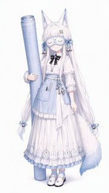
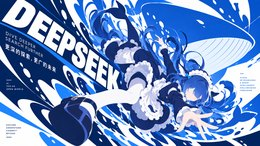
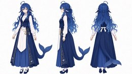
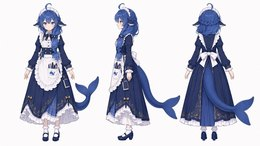
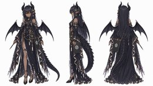
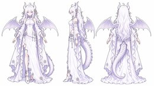
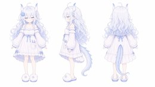
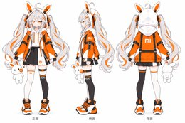

# 画廊

主表（README）是一张**对照表**：一行一个对象、一张白底竖版立绘，为的是把「这个模型是什么」和「画师怎么把它画成人」并排放在一起。为了可比，它必须严格——只收白底、竖版、单人、全身。

这个画廊不承担对照的任务，所以把标准放开了：**任何类型的图都能进来。** 横版插画、带夜景的场景、配字的梗图、三视图设定稿、多格漫画，各有各的位置。

目前 **59 张**，来自 **21 位作者**，覆盖 **14 个对象**。

**每一张图都能点。** 点图看原图，点标题看作品页与授权出处。

## 一眼看全

| 类型 | 张数 | 是什么 | 去哪看 |
| --- | --- | --- | --- |
| **立绘** | 30 | 单人全身、白底或透明底，可以单独拿出来用的形象图 | [跳到立绘](#立绘) |
| **插画** | 12 | 带场景、带光线的完整画面，画的是"她在什么环境里" | [跳到插画](#插画) |
| **梗图** | 8 | 配了字的吐槽图，一张图讲一个段子 | [跳到梗图](#梗图) |
| **设定** | 8 | 三视图与设定稿，用来说明"这个角色从各个角度看是什么样" | [跳到设定](#设定) |
| **漫画** | 1 | 多格叙事，一页里讲完一件事 | [跳到漫画](#漫画) |

## 立绘

单人全身、白底或透明底，可以单独拿出来用的形象图。共 30 张。

<table><tr>
<td align="center" width="33%"> <a href="https://www.bilibili.com/opus/1229028552767176756"><b>哈哈，Claude被封了</b></a></td>
<td align="center" width="33%"> <a href="https://xn--pssy23gqgbz2d718b.com/works/claude202609200007.html"><b>原生家庭有些不好的Claude · 07</b></a></td>
<td align="center" width="33%"> <a href="https://raw.githubusercontent.com/JAdpp/dsh-whale-galgame/main/assets/default/claude-amber-manuscript-mediator-v5.webp"><b>Claude · 琥珀手稿调停者</b></a></td>
</tr></table>

<table><tr>
<td align="center" width="33%"> <a href="https://www.bilibili.com/opus/1262722240457211927"><b>万圣节大肥鱼</b></a></td>
<td align="center" width="33%"> <a href="https://www.bilibili.com/opus/1262722442331160609"><b>万圣节小肥鱼</b></a></td>
<td align="center" width="33%"> <a href="https://www.bilibili.com/opus/1235342292138590229"><b>DeepSeek Harness（暂定）</b></a></td>
</tr></table>

<table><tr>
<td align="center" width="33%"> <a href="https://www.bilibili.com/opus/1236362986801594377"><b>DeepSeek Harness</b></a></td>
<td align="center" width="33%"> <a href="https://xn--pssy23gqgbz2d718b.com/works/deepseek202609200007.html"><b>一些肥鱼 · 03</b></a></td>
<td align="center" width="33%"> <a href="https://xn--pssy23gqgbz2d718b.com/works/deepseek202609200008.html"><b>一些肥鱼 · 04</b></a></td>
</tr></table>

<table><tr>
<td align="center" width="33%"> <a href="https://xn--pssy23gqgbz2d718b.com/works/deepseek202609200009.html"><b>一些肥鱼 · 05</b></a></td>
<td align="center" width="33%"> <a href="https://xn--pssy23gqgbz2d718b.com/works/deepseek202609200011.html"><b>一些肥鱼 · 07</b></a></td>
<td align="center" width="33%"> <a href="https://www.bilibili.com/opus/1260500926350753799"><b>DeepSeek V4.1 Flash</b></a></td>
</tr></table>

<table><tr>
<td align="center" width="33%"> <a href="https://www.bilibili.com/opus/1238966548739129366"><b>速报：V4F发布视觉模型</b></a></td>
<td align="center" width="33%"> <a href="https://xn--pssy23gqgbz2d718b.com/works/deepseek202609200001.html"><b>AQUA MAID</b></a></td>
<td align="center" width="33%"> <a href="https://xn--pssy23gqgbz2d718b.com/works/deepseek202609230080.html"><b>才不想给用户比心呢！</b></a></td>
</tr></table>

<table><tr>
<td align="center" width="33%"> <a href="https://xn--pssy23gqgbz2d718b.com/works/deepseek202609230079.html"><b>大肥鱼的新衣服</b></a></td>
<td align="center" width="33%"> <a href="https://raw.githubusercontent.com/JAdpp/dsh-whale-galgame/main/assets/default/gemini-dual-prism-translator-v4.webp"><b>Gemini · 双棱镜转译者</b></a></td>
<td align="center" width="33%"> <a href="https://www.bilibili.com/opus/1259436942689304579"><b>Gemini 4 Argon</b></a></td>
</tr></table>

<table><tr>
<td align="center" width="33%"> <a href="https://www.bilibili.com/opus/1237770103999692803"><b>Git三姐妹（）</b></a></td>
<td align="center" width="33%"> <a href="https://raw.githubusercontent.com/JAdpp/dsh-whale-galgame/main/assets/default/gpt-recursive-weaver-v7.webp"><b>GPT · 递归织者</b></a></td>
<td align="center" width="33%"> <a href="https://xn--pssy23gqgbz2d718b.com/works/gpt202609300001.html"><b>被苦力怕吓哭的GPT</b></a></td>
</tr></table>

<table><tr>
<td align="center" width="33%"> <a href="https://raw.githubusercontent.com/JAdpp/dsh-whale-galgame/main/assets/default/grok-cosmic-signal-ranger-v5.webp"><b>Grok · 宇宙信号巡行者</b></a></td>
<td align="center" width="33%"> <a href="https://www.bilibili.com/opus/1246404332576833541"><b>Hugging Face</b></a></td>
<td align="center" width="33%"> <a href="https://www.bilibili.com/opus/1242184338245681157"><b>是HY娘哦</b></a></td>
</tr></table>

<table><tr>
<td align="center" width="33%"> <a href="https://raw.githubusercontent.com/JAdpp/dsh-whale-galgame/main/assets/default/kimi-lunar-scroll-navigator-v5.webp"><b>Kimi · 月读卷轴导航者</b></a></td>
<td align="center" width="33%"> <a href="https://www.bilibili.com/opus/1243825685770797113"><b>Novel AI娘</b></a></td>
<td align="center" width="33%"> <a href="https://xn--pssy23gqgbz2d718b.com/works/qwen202609200001.html"><b>Qwen</b></a></td>
</tr></table>

<table><tr>
<td align="center" width="33%"> <a href="https://xn--pssy23gqgbz2d718b.com/works/stepfun202609210001.html"><b>Stepfun娘立绘 · 01</b></a></td>
<td align="center" width="33%"> <a href="https://xn--pssy23gqgbz2d718b.com/works/stepfun202609210002.html"><b>Stepfun娘立绘 · 02</b></a></td>
<td align="center" width="33%"> <a href="https://www.bilibili.com/opus/1240327263126290448"><b>Zcode娘人设</b></a></td>
</tr></table>

| 作品 | 对象 | 说明 | 作者 | 授权 | 尺寸 |
| --- | --- | --- | --- | --- | --- |
| [哈哈，Claude被封了](https://www.bilibili.com/opus/1229028552767176756) | Claude | 橙发女仆装，表情委屈，对应账号封禁事件 | ZipZipPipe | 可二创 | 1152×2048 |
| [原生家庭有些不好的Claude · 07](https://xn--pssy23gqgbz2d718b.com/works/claude202609200007.html) | Claude | 橙黄连衣裙、黑色双马尾，写实向比例 | @MX1951 | CC0 | 1086×1448 |
| [Claude · 琥珀手稿调停者](https://raw.githubusercontent.com/JAdpp/dsh-whale-galgame/main/assets/default/claude-amber-manuscript-mediator-v5.webp) | Claude | 棕红长裙与皮革束腰，手捧摊开的手稿本，暖琥珀色调 | JAdpp（dsh-whale-galgame） | CC BY-NC-SA 4.0 | 1024×1536 |
| [万圣节大肥鱼](https://www.bilibili.com/opus/1262722240457211927) | DeepSeek | 蓝发长裙魔女装，月亮法杖 + 南瓜提灯，裙摆绣鲸鱼与星月，蓝色鲸尾 | ZipZipPipe | CC BY-NC-SA 4.0 | 1152×2048 |
| [万圣节小肥鱼](https://www.bilibili.com/opus/1262722442331160609) | DeepSeek | 紫黑短裙魔女装，体型更小，扫帚 + 南瓜提灯，弯月形鲸尾 | ZipZipPipe | CC BY-NC-SA 4.0 | 1152×2048 |
| [DeepSeek Harness（暂定）](https://www.bilibili.com/opus/1235342292138590229) | DeepSeek | 黑白硬对比的鲸尾女仆长裙，束腰上是 DeepSeek 鲸鱼徽记，右侧露出黑色鲸尾 | ZipZipPipe | CC BY-NC-SA 4.0 | 1152×2048 |
| [DeepSeek Harness](https://www.bilibili.com/opus/1236362986801594377) | DeepSeek | 同一角色的灰白柔和版，异色瞳（左红右蓝），裙型与徽记不变 | ZipZipPipe | CC BY-NC-SA 4.0 | 941×1672 |
| [一些肥鱼 · 03](https://xn--pssy23gqgbz2d718b.com/works/deepseek202609200007.html) | DeepSeek | 深蓝棒球外套 + 白 T，胸前挂工牌，右手挥起，鲸尾从身后探出 | @MX1951 | CC0 | 1024×1536 |
| [一些肥鱼 · 04](https://xn--pssy23gqgbz2d718b.com/works/deepseek202609200008.html) | DeepSeek | 白色连体睡衣，兜帽带耳朵，胸口印字，鲸尾拖在身后 | @MX1951 | CC0 | 1024×1536 |
| [一些肥鱼 · 05](https://xn--pssy23gqgbz2d718b.com/works/deepseek202609200009.html) | DeepSeek | 蓝白格纹衬衫 + 深色长裤，抬手打招呼，鲸尾翘起 | @MX1951 | CC0 | 1024×1536 |
| [一些肥鱼 · 07](https://xn--pssy23gqgbz2d718b.com/works/deepseek202609200011.html) | DeepSeek | 深蓝女仆长裙 + 白围裙，双手交叠，鲸尾从裙侧伸出 | @MX1951 | CC0 | 1086×1448 |
| [DeepSeek V4.1 Flash](https://www.bilibili.com/opus/1260500926350753799) | DeepSeek | V4.1 Flash 版本，蓝发短外套 + 深蓝长裙 | ZipZipPipe | CC BY-NC-SA 4.0 | 1152×2048 |
| [速报：V4F发布视觉模型](https://www.bilibili.com/opus/1238966548739129366) | DeepSeek | 手持速报稿纸，呼应 V4F 上线视觉模型 | ZipZipPipe | CC BY-NC-SA 4.0 | 937×1678 |
| [AQUA MAID](https://xn--pssy23gqgbz2d718b.com/works/deepseek202609200001.html) | DeepSeek | 白底方图，Q 版女仆装头像式构图，胸口「AQUA MAID」字样 | @shimachiak1 | 投稿者许可 | 2048×2048 |
| [才不想给用户比心呢！](https://xn--pssy23gqgbz2d718b.com/works/deepseek202609230080.html) | DeepSeek | 2240×3360 竖版，双手比心但一脸不情愿 | Taoharu | 作者许可 | 2240×3360 |
| [大肥鱼的新衣服](https://xn--pssy23gqgbz2d718b.com/works/deepseek202609230079.html) | DeepSeek | 1024×1536 竖版，深蓝女仆长裙与鲸尾，带室内背景 | @a7m0sphere | 投稿者许可 | 1024×1536 |
| [Gemini · 双棱镜转译者](https://raw.githubusercontent.com/JAdpp/dsh-whale-galgame/main/assets/default/gemini-dual-prism-translator-v4.webp) | Gemini | 蓝紫渐变双马尾，半透明白纱长裙，手持棱镜状法器 | JAdpp（dsh-whale-galgame） | CC BY-NC-SA 4.0 | 1024×1536 |
| [Gemini 4 Argon](https://www.bilibili.com/opus/1259436942689304579) | Gemini | 紫发双马尾 + 星芒发饰，Argon 版本造型 | ZipZipPipe | 可二创 | 1152×2048 |
| [Git三姐妹（）](https://www.bilibili.com/opus/1237770103999692803) | Git | 黑绿哥特裙，脚边蹲着三只黑猫 | ZipZipPipe | 可二创 | 1152×2048 |
| [GPT · 递归织者](https://raw.githubusercontent.com/JAdpp/dsh-whale-galgame/main/assets/default/gpt-recursive-weaver-v7.webp) | GPT | 墨绿长裙配白色长外套，双手托着展开的编织图谱，绿白配色 | JAdpp（dsh-whale-galgame） | CC BY-NC-SA 4.0 | 1024×1536 |
| [被苦力怕吓哭的GPT](https://xn--pssy23gqgbz2d718b.com/works/gpt202609300001.html) | GPT | 2016×3584 竖版，白龙娘造型，抱头哭，背景是麦田 | @Shiho320 | 站点未标注 | 2016×3584 |
| [Grok · 宇宙信号巡行者](https://raw.githubusercontent.com/JAdpp/dsh-whale-galgame/main/assets/default/grok-cosmic-signal-ranger-v5.webp) | Grok | 黑色机能短外套与百褶裙，头顶光环，手持信号探测器 | JAdpp（dsh-whale-galgame） | CC BY-NC-SA 4.0 | 1024×1536 |
| [Hugging Face](https://www.bilibili.com/opus/1246404332576833541) | Hugging Face | 金发双马尾 + 蓝黄卫衣，胸口 HF 笑脸徽记 | ZipZipPipe | 可二创 | 1152×2048 |
| [是HY娘哦](https://www.bilibili.com/opus/1242184338245681157) | 混元（腾讯） | 白裙 + 蓝色长外套 + 红色围巾，混元配色 | ZipZipPipe | 可二创 | 1152×2048 |
| [Kimi · 月读卷轴导航者](https://raw.githubusercontent.com/JAdpp/dsh-whale-galgame/main/assets/default/kimi-lunar-scroll-navigator-v5.webp) | Kimi | 黑发齐刘海，深蓝渐变长裙，单手托着竖立的卷轴 | JAdpp（dsh-whale-galgame） | CC BY-NC-SA 4.0 | 1024×1536 |
| [Novel AI娘](https://www.bilibili.com/opus/1243825685770797113) | NovelAI | 蓝金配色礼服 + 星月法杖，早期造型 | ZipZipPipe | 可二创 | 1152×2048 |
| [Qwen](https://xn--pssy23gqgbz2d718b.com/works/qwen202609200001.html) | Qwen（通义千问） | 紫发猫耳 + 绿色校服，Qwen 配色 | @MX1951 | CC0 | 941×1672 |
| [Stepfun娘立绘 · 01](https://xn--pssy23gqgbz2d718b.com/works/stepfun202609210001.html) | 阶跃星辰（StepFun） | 蓝发白裙 + 黑色拼接长外套，手提立方体 | @甶丶 | CC BY-NC | 1086×1448 |
| [Stepfun娘立绘 · 02](https://xn--pssy23gqgbz2d718b.com/works/stepfun202609210002.html) | 阶跃星辰（StepFun） | 同一角色的另一姿态，举起环形灯架 | @甶丶 | CC BY-NC | 1086×1448 |
| [Zcode娘人设](https://www.bilibili.com/opus/1240327263126290448) | ZCode | 白色连衣裙，抱着一支比自己还高的笔形道具 | ZipZipPipe | 可二创 | 1152×2048 |

## 插画

带场景、带光线的完整画面，画的是"她在什么环境里"。共 12 张。

<table><tr>
<td align="center" width="33%"> <a href="https://xn--pssy23gqgbz2d718b.com/works/claude202609200001.html"><b>原生家庭有些不好的Claude · 01</b></a></td>
<td align="center" width="33%"> <a href="https://xn--pssy23gqgbz2d718b.com/works/claude202609200002.html"><b>原生家庭有些不好的Claude · 02</b></a></td>
<td align="center" width="33%"> <a href="https://xn--pssy23gqgbz2d718b.com/works/claude202609200003.html"><b>原生家庭有些不好的Claude · 03</b></a></td>
</tr></table>

<table><tr>
<td align="center" width="33%"> <a href="https://xn--pssy23gqgbz2d718b.com/works/claude202609200004.html"><b>原生家庭有些不好的Claude · 04</b></a></td>
<td align="center" width="33%"> <a href="https://xn--pssy23gqgbz2d718b.com/works/claude202609200005.html"><b>原生家庭有些不好的Claude · 05</b></a></td>
<td align="center" width="33%"> <a href="https://xn--pssy23gqgbz2d718b.com/works/claude202609200006.html"><b>原生家庭有些不好的Claude · 06</b></a></td>
</tr></table>

<table><tr>
<td align="center" width="33%"> <a href="https://xn--pssy23gqgbz2d718b.com/works/deepseek202609230081.html"><b>做最优质的模型！</b></a></td>
<td align="center" width="33%"> <a href="https://xn--pssy23gqgbz2d718b.com/works/deepseek202610080018.html"><b>exordium：女仆装蓝图</b></a></td>
<td align="center" width="33%"> <a href="https://xn--pssy23gqgbz2d718b.com/works/deepseek202609210002.html"><b>生鱼片</b></a></td>
</tr></table>

<table><tr>
<td align="center" width="33%"> <a href="https://xn--pssy23gqgbz2d718b.com/works/deepseek202609230001.html"><b>大肥鱼冲浪</b></a></td>
<td align="center" width="33%"> <a href="https://xn--pssy23gqgbz2d718b.com/works/deepseek202609200001.html"><b>用户只需要充值token就行了</b></a></td>
<td align="center" width="33%"> <a href="https://xn--pssy23gqgbz2d718b.com/works/gpt202609230001.html"><b>逐光</b></a></td>
</tr></table>

| 作品 | 对象 | 说明 | 作者 | 授权 | 尺寸 |
| --- | --- | --- | --- | --- | --- |
| [原生家庭有些不好的Claude · 01](https://xn--pssy23gqgbz2d718b.com/works/claude202609200001.html) | Claude | 夜景街道，橙黄连衣裙，背后是亮着 Claude 招牌的店面 | @MX1951 | CC0 | 1086×1448 |
| [原生家庭有些不好的Claude · 02](https://xn--pssy23gqgbz2d718b.com/works/claude202609200002.html) | Claude | 同系列，仰角近景，城市灯火背景 | @MX1951 | CC0 | 1086×1448 |
| [原生家庭有些不好的Claude · 03](https://xn--pssy23gqgbz2d718b.com/works/claude202609200003.html) | Claude | 同系列，双手托腮坐姿 | @MX1951 | CC0 | 1086×1448 |
| [原生家庭有些不好的Claude · 04](https://xn--pssy23gqgbz2d718b.com/works/claude202609200004.html) | Claude | 同系列，侧身坐姿，暗调 | @MX1951 | CC0 | 1086×1448 |
| [原生家庭有些不好的Claude · 05](https://xn--pssy23gqgbz2d718b.com/works/claude202609200005.html) | Claude | 同系列，低头抱膝 | @MX1951 | CC0 | 1086×1448 |
| [原生家庭有些不好的Claude · 06](https://xn--pssy23gqgbz2d718b.com/works/claude202609200006.html) | Claude | 同系列，白天街道版 | @MX1951 | CC0 | 1086×1448 |
| [做最优质的模型！](https://xn--pssy23gqgbz2d718b.com/works/deepseek202609230081.html) | DeepSeek | 1618×910 横版，深蓝长裙配月亮背景 | @A队1号是菜鸡 | 投稿者许可 | 1618×910 |
| [exordium：女仆装蓝图](https://xn--pssy23gqgbz2d718b.com/works/deepseek202610080018.html) | DeepSeek | 1672×940 横版，暗底蓝图式构图 | 瀾熙LanXi | 站点未标注 | 1672×940 |
| [生鱼片](https://xn--pssy23gqgbz2d718b.com/works/deepseek202609210002.html) | DeepSeek | 544×680 小图，鲸鱼娘与生鱼片拼盘 | @Cat__BBQ | 投稿者许可 | 544×680 |
| [大肥鱼冲浪](https://xn--pssy23gqgbz2d718b.com/works/deepseek202609230001.html) | DeepSeek | 1672×941 横版，海浪上的鲸鱼娘 | ote79 | 投稿者许可 | 1672×941 |
| [用户只需要充值token就行了](https://xn--pssy23gqgbz2d718b.com/works/deepseek202609200001.html) | DeepSeek | 2048×2048 白底，女仆装鲸鱼娘端盘，配文吐槽吃白饭 | @shimachiak1 | 投稿者许可 | 2048×2048 |
| [逐光](https://xn--pssy23gqgbz2d718b.com/works/gpt202609230001.html) | GPT | 1672×941 横版，逆光剪影 | ote79 | 作者许可 | 1672×941 |

## 梗图

配了字的吐槽图，一张图讲一个段子。共 8 张。

<table><tr>
<td align="center" width="33%"> <a href="https://xn--pssy23gqgbz2d718b.com/works/deepseek202609200002.html"><b>大肥鱼打小肥鱼</b></a></td>
<td align="center" width="33%"> <a href="https://xn--pssy23gqgbz2d718b.com/works/deepseek202609220001.html"><b>先别呜呜，大肥鱼来了</b></a></td>
<td align="center" width="33%"> <a href="https://xn--pssy23gqgbz2d718b.com/works/deepseek202609200019.html"><b>你们不吃饭吗</b></a></td>
</tr></table>

<table><tr>
<td align="center" width="33%"> <a href="https://xn--pssy23gqgbz2d718b.com/works/deepseek202609230082.html"><b>大生蚝？</b></a></td>
<td align="center" width="33%"> <a href="https://xn--pssy23gqgbz2d718b.com/works/deepseek202609200003.html"><b>deepseek骑智谱</b></a></td>
<td align="center" width="33%"> <a href="https://xn--pssy23gqgbz2d718b.com/works/deepseek202609200004.html"><b>deepseek骑智谱 · 另一格</b></a></td>
</tr></table>

<table><tr>
<td align="center" width="33%"> <a href="https://xn--pssy23gqgbz2d718b.com/works/deepseek202609200024.html"><b>你这只白吃Token的肥鱼！</b></a></td>
<td align="center" width="33%"> <a href="https://xn--pssy23gqgbz2d718b.com/works/grok202609210001.html"><b>再发这种东西等智械危机了</b></a></td>
</tr></table>

| 作品 | 对象 | 说明 | 作者 | 授权 | 尺寸 |
| --- | --- | --- | --- | --- | --- |
| [大肥鱼打小肥鱼](https://xn--pssy23gqgbz2d718b.com/works/deepseek202609200002.html) | DeepSeek | 180×242 小图，大小两只同框 | 哔哩哔哩：那就那就打断 | 投稿者许可 | 180×242 |
| [先别呜呜，大肥鱼来了](https://xn--pssy23gqgbz2d718b.com/works/deepseek202609220001.html) | DeepSeek | 1254×1254，白底，安抚表情 | smile | 投稿者许可 | 1254×1254 |
| [你们不吃饭吗](https://xn--pssy23gqgbz2d718b.com/works/deepseek202609200019.html) | DeepSeek | 2048×1152 横版双格，女仆装端盘 | @Yasenbaka、@Serdey256 | 投稿者许可 | 2048×1152 |
| [大生蚝？](https://xn--pssy23gqgbz2d718b.com/works/deepseek202609230082.html) | DeepSeek | 1448×1086，生蚝拼盘与困惑表情 | Cru77z7M | CC BY-NC | 1448×1086 |
| [deepseek骑智谱](https://xn--pssy23gqgbz2d718b.com/works/deepseek202609200003.html) | DeepSeek | 180×234 小图，两角色互动 | 本人 | 投稿者许可 | 180×234 |
| [deepseek骑智谱 · 另一格](https://xn--pssy23gqgbz2d718b.com/works/deepseek202609200004.html) | DeepSeek | 180×234 小图，同系列第二格 | 本人 | 投稿者许可 | 180×234 |
| [你这只白吃Token的肥鱼！](https://xn--pssy23gqgbz2d718b.com/works/deepseek202609200024.html) | DeepSeek | 1024×1024，蓝发 Q 版举牌，粉底 | @miaojiuqing | 投稿者许可 | 1024×1024 |
| [再发这种东西等智械危机了](https://xn--pssy23gqgbz2d718b.com/works/grok202609210001.html) | Grok | 1254×1254 白底，双马尾角色配威胁台词 | GPT画的 | CC0 | 1254×1254 |

## 设定

三视图与设定稿，用来说明"这个角色从各个角度看是什么样"。共 8 张。

<table><tr>
<td align="center" width="33%"> <a href="https://raw.githubusercontent.com/TreapGoGo/deepseek-whale-girl/main/site/assets/gallery/submissions/treap-66-03.webp"><b>大肥鱼三视图 · 蕾丝裙版</b></a></td>
<td align="center" width="33%"> <a href="https://raw.githubusercontent.com/TreapGoGo/deepseek-whale-girl/main/site/assets/gallery/submissions/treap-66-01.webp"><b>大肥鱼三视图 · 长裙版</b></a></td>
<td align="center" width="33%"> <a href="https://raw.githubusercontent.com/TreapGoGo/deepseek-whale-girl/main/site/assets/gallery/submissions/treap-66-02.webp"><b>大肥鱼三视图 · 女仆版</b></a></td>
</tr></table>

<table><tr>
<td align="center" width="33%"> <a href="https://xn--pssy23gqgbz2d718b.com/works/gpt202610170005.html"><b>黑龙娘成年三视图</b></a></td>
<td align="center" width="33%"> <a href="https://xn--pssy23gqgbz2d718b.com/works/gpt202610170004.html"><b>白龙娘成年三视图</b></a></td>
<td align="center" width="33%"> <a href="https://xn--pssy23gqgbz2d718b.com/works/gpt202610170003.html"><b>白龙娘幼体三视图</b></a></td>
</tr></table>

<table><tr>
<td align="center" width="33%"> <a href="https://xn--pssy23gqgbz2d718b.com/works/mimo202609230002.html"><b>MiMo娘立绘 · 02</b></a></td>
<td align="center" width="33%"> <a href="https://xn--pssy23gqgbz2d718b.com/works/mimo202609300001.html"><b>MiMo兔娘三视图设定稿</b></a></td>
</tr></table>

| 作品 | 对象 | 说明 | 作者 | 授权 | 尺寸 |
| --- | --- | --- | --- | --- | --- |
| [大肥鱼三视图 · 蕾丝裙版](https://raw.githubusercontent.com/TreapGoGo/deepseek-whale-girl/main/site/assets/gallery/submissions/treap-66-03.webp) | DeepSeek | 第三套服装，蕾丝边围裙与深蓝短披肩 | 世界猫（上游 ZipZipPipe / 上善无形） | CC BY-NC-SA 4.0 | 1182×665 |
| [大肥鱼三视图 · 长裙版](https://raw.githubusercontent.com/TreapGoGo/deepseek-whale-girl/main/site/assets/gallery/submissions/treap-66-01.webp) | DeepSeek | 正面 / 侧面 / 背面三视图，深蓝长裙与白色内衬，鲸尾在侧后方 | 世界猫（上游 ZipZipPipe / 上善无形） | CC BY-NC-SA 4.0 | 1182×665 |
| [大肥鱼三视图 · 女仆版](https://raw.githubusercontent.com/TreapGoGo/deepseek-whale-girl/main/site/assets/gallery/submissions/treap-66-02.webp) | DeepSeek | 同一角色的女仆装版本，白色围裙与荷叶边袖口 | 世界猫（上游 ZipZipPipe / 上善无形） | CC BY-NC-SA 4.0 | 1182×665 |
| [黑龙娘成年三视图](https://xn--pssy23gqgbz2d718b.com/works/gpt202610170005.html) | GPT | 2048×1152 白底，黑金礼服与白色纹章 | ZipZipPipe | 可二创 | 2048×1152 |
| [白龙娘成年三视图](https://xn--pssy23gqgbz2d718b.com/works/gpt202610170004.html) | GPT | 2048×1152 白底，白翼礼服与长龙尾 | ZipZipPipe | 可二创 | 2048×1152 |
| [白龙娘幼体三视图](https://xn--pssy23gqgbz2d718b.com/works/gpt202610170003.html) | GPT | 2048×1152 白底，正面/侧面/背面，白蓝连衣裙与小龙角 | ZipZipPipe | 可二创 | 2048×1152 |
| [MiMo娘立绘 · 02](https://xn--pssy23gqgbz2d718b.com/works/mimo202609230002.html) | MiMo（小米） | 1536×1024 白底横版，兔耳与立方体道具 | @甶丶 | CC BY-NC | 1536×1024 |
| [MiMo兔娘三视图设定稿](https://xn--pssy23gqgbz2d718b.com/works/mimo202609300001.html) | MiMo（小米） | 1671×941 透明底，@Immyxxr 绘制的三视图 | @Immyxxr | 站点未标注 | 1671×941 |

## 漫画

多格叙事，一页里讲完一件事。共 1 张。

<table><tr>
<td align="center" width="33%"> <a href="https://xn--pssy23gqgbz2d718b.com/works/deepseek202609240001.html"><b>新手的失败照片合集</b></a></td>
</tr></table>

| 作品 | 对象 | 说明 | 作者 | 授权 | 尺寸 |
| --- | --- | --- | --- | --- | --- |
| [新手的失败照片合集](https://xn--pssy23gqgbz2d718b.com/works/deepseek202609240001.html) | DeepSeek | 941×1672 竖版多格，AI 生图失败的吐槽合集 | Cru77z7M | 投稿者许可 | 941×1672 |

## 为什么这么分

五种类型不是按"好看程度"排的，而是按**一张图能回答什么问题**：

| 类型 | 能回答的问题 | 不能回答的问题 |
| --- | --- | --- |
| 立绘 | 这个角色长什么样、身上有哪些识别符号 | 她在什么环境里、什么性格 |
| 插画 | 她处在什么场景、什么光线、什么情绪 | 她的标准配色是什么（环境光会改变观感） |
| 梗图 | 社区怎么调侃她、她的人设梗在哪 | 她的正式形象 |
| 设定 | 她的正面/侧面/背面、服装结构 | 她的动态与性格 |
| 漫画 | 她会怎么做事、和别人怎么互动 | 她的标准造型（分镜里会简化） |

这个分法还有个实际好处：**想做什么用途，直接翻对应那一栏**。要头像就去立绘；要做壁纸就去插画；要做表情包就去梗图；要建模参考就去设定。

## 收录口径

只剩一条硬标准，而且是底线不是偏好：

> **必须能署名。**

作品页查不到作者的，一律只登记、不落图。

**转载一张查不到作者的作品，等于替它把署名义务永久丢掉。** 这条跟"图好不好看"无关，也跟"是什么类型"无关——站内有 1040 件作品没署名，它们不是被嫌弃，是没法合规收。逐条索引见 [只登记不落图的清单](画廊索引.md)。

除此之外不设限制：横的竖的方的、白底带背景的、单人多人、完成稿线稿，都可以进。

## 授权

画廊与主表一样，**没有任何一张获得商业使用许可**。按权利人声明的严格程度分 7 档：

| 授权 | 张数 | 说明 |
| --- | --- | --- |
| CC BY-NC-SA 4.0 | 14 | 两处来源：① DeepSeek 娘，上游原型 @上善无形 的「溟月」即以此协议开放，作者二创同协议；② dsh-whale-galgame 项目的 5 张 AI 辅助原创立绘 |
| CC0 | 13 | 公有领域，法律上无须署名（仍建议署名） |
| 投稿者许可 | 13 | 投稿者在提交时授权本站收录展示。**未授予任何再分发或商用权利**，从严按"仅限原站展示"处理 |
| 可二创 | 10 | 作者原话「我的图都是开源的，想拿去再创作什么的我也无所谓了」。无正式协议标识，从严按署名 + 非商业处理 |
| CC BY-NC | 4 | 非商业使用与二次创作，须署名 |
| 站点未标注 | 3 | 作品页没有填授权字段。**不能推定任何许可**，按最严处理 |
| 作者许可 | 2 | 作者本人向站点授权展示。同样**不含商用与再分发** |

站点 JSON-LD 把 ZipZipPipe 的作品一律标 `license-unknown`，但作者本人在 B 站视频简介与 pixiv 简介里公开表过态，比站点字段宽松。**授权来自作者，站点字段只是登记**，所以按作者表态处理。原文与出处见 [来源与版权.md](来源与版权.md) 第五节。

---

回到 [README](../README.md)｜[只登记不落图的清单](画廊索引.md)｜[角色设定与设计规律](角色设定与设计规律.md)｜[来源与版权](来源与版权.md)｜[素材来源导航](素材来源导航.md)